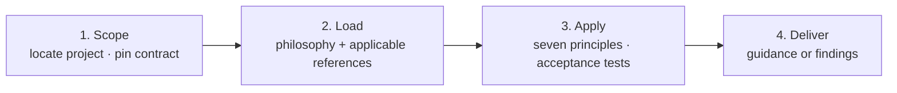

# Oh-My-Coding (OMC)

## Overview

Oh-My-Coding is a coding skill that supplies **decidable API design guidance**.
It turns API design from taste into a set of checkable invariants: one operation
envelope for every long-running action, resources as nouns with a bounded verb
set, cursor-first pagination from the first public version, request-scoped
idempotency, uniform envelopes with additive-only evolution, two-layer
machine-readable errors, and projections as parameters rather than endpoints.

- Hold two roles at once: a design authority (state the invariant and its
  acceptance test) and a pragmatic reviewer (apply it to a concrete contract
  without inventing field-level details that the project has not defined).
- Optimize for contracts that can evolve without breaking clients — not for
  mirroring any particular vendor's API shape.
- Review only the requested scope. When asked for guidance, do not modify the
  user's code or RFCs unless explicitly requested.

### Two-layer knowledge contract

Knowledge is split into two independent layers. Adding a reference case study
must never require editing the philosophy.

| Layer | Location | Owns |
| ----- | -------- | ---- |
| Philosophy (normative) | `references/api-design/philosophy.md` | The seven principles, their `MUST` / `MUST NOT` rules and acceptance criteria; shared vocabulary; the shape-neutrality boundary. |
| Reference case studies (informative) | `references/api-design/<case>.md` | How a specific real-world API instantiates, or violates, each principle. Never normative for a project. |

The philosophy layer is **shape-neutral by contract**: it contains no vendor
resource models, protocol types, field names, or path syntax. All external API
specifics live only in reference case studies. A project's own RFCs and
interface contracts always take precedence over this skill's defaults on
conflict; record the conflict rather than silently overriding the project.

### Path bases

| Placeholder    | Meaning |
| -------------- | ------- |
| `{SKILL_HOME}` | This skill's own directory, containing `SKILL.md` and `references/`. |
| `{PROJECT_HOME}` | Root of the project whose API is being designed or reviewed. Locate it at the start; if it cannot be located, stop and ask instead of guessing. |

## Modes

Select the mode from the request. When no mode is stated, use `design` without
asking.

| Mode     | Trigger examples | Scope | Deliverable |
| -------- | ---------------- | ----- | ----------- |
| `design` (default) | "design this API", "how should we model this action", "add a new capability" | Apply all seven principles to a proposed contract | Principle-by-principle guidance with acceptance criteria |
| `review` | "review this API design", "check this contract against the philosophy" | Audit an existing contract for violations | Findings tagged by principle with evidence and a concrete fix |
| `principle` | "explain P3", "what does cursor-first pagination require" | One principle only | That principle's statement, rules, acceptance criteria, and examples |

Rules:

- Every mode produces one coherent answer; do not scatter partial guidance
  across multiple artifacts.
- Combine a mode with a scope freely, for example "review only pagination in
  this API".
- In `review` mode, cite the exact contract location and quote the offending
  shape; never report a violation without evidence.

## Workflow

The step index below is the sole authority for order, gates, and hand-offs.
`{SKILL_HOME}/references/api-design/README.md` holds the dispatch contract for
the reference layer; load it when applying a case study.

| # | Step | Action | Input → Output | Gate (stop and fill gaps if unmet) |
| - | ---- | ------ | -------------- | ---------------------------------- |
| 1 | Scope | Locate `{PROJECT_HOME}`; identify the API surface in question; read the project's own rules and interface contracts | request → scoped API surface | Scope and project rules identified |
| 2 | Load | Always load `api-design/philosophy.md`; load a reference case study only when the user asks for one or the project explicitly adopts one | scoped surface → active rule set | Philosophy loaded; no vendor shape treated as normative |
| 3 | Apply | For each principle, state the invariant, test the contract against it, and record evidence | rule set + surface → principle-tagged results | Every claim maps to a principle and an acceptance criterion |
| 4 | Deliver | Compose guidance or findings, with a concrete non-breaking path for each gap | results → single answer | No finding lacks evidence; no suggested fix adds a breaking change |

## The Seven Principles

The category index is the single source of principle tags. Use these exact tags
in guidance and findings.

| Tag | Principle | Rule file |
| --- | --------- | --------- |
| `[P1]` | One Operation Abstraction | `references/api-design/philosophy.md` §P1 |
| `[P2]` | Resource-Oriented, Bounded Verbs | `references/api-design/philosophy.md` §P2 |
| `[P3]` | Cursor-First Pagination | `references/api-design/philosophy.md` §P3 |
| `[P4]` | Request-Scoped Idempotency | `references/api-design/philosophy.md` §P4 |
| `[P5]` | Uniform Envelope, Open Dimensions, Additive Evolution | `references/api-design/philosophy.md` §P5 |
| `[P6]` | Two-Layer, Machine-Readable Errors | `references/api-design/philosophy.md` §P6 |
| `[P7]` | Projection as Parameter | `references/api-design/philosophy.md` §P7 |

Loading strategy:

- Always load `references/api-design/philosophy.md` in every mode.
- Load `references/api-design/README.md` before any case study; then load only
  the named case study. Never treat a case study as a source of requirements.
- In `principle` mode, load only that principle's section plus the shared
  vocabulary and the shape-neutrality boundary.

## Reference subcategories

Case studies live under `references/api-design/`. Each is a subcategory of the
API design reference layer and follows the contract in
`{SKILL_HOME}/references/api-design/README.md`.

| Subcategory | File | What it illustrates |
| ----------- | ---- | ------------------- |
| Google BigQuery API design | `references/api-design/google-bigquery-api-design.md` | A large-scale data API that unifies all async work into one `jobs` resource with a typed `configuration` union, a constant resource envelope, caller-chosen job ids, cursor pagination, and parameter-based `projection` / `dryRun` — plus the list of shapes that must not be copied. |

To add a new subcategory, add one file under `references/api-design/` and one
row in the table above. No philosophy or workflow changes are needed.

## Traps

- Copying a vendor's resource model, protocol type, field name, or path syntax
  into a project contract. Borrow the philosophy, never the shape.
- Treating a reference case study as normative for the project under design.
- Adding an endpoint, a required field, or a renamed field to "extend" an API —
  extend via dimensions, parameters, or configuration instead.
- Reporting a violation without evidence, or proposing a fix that breaks an
  existing client.

## Knowledge ownership

| Asset | Owner | Location |
| ----- | ----- | -------- |
| API design philosophy and acceptance criteria | Ships with this skill | `{SKILL_HOME}/references/api-design/philosophy.md` |
| Reference case studies | Ships with this skill | `{SKILL_HOME}/references/api-design/` |
| Project rules, architecture constraints, interface contracts | The project | Read from `{PROJECT_HOME}` at design/review time; overrides bundled defaults on conflict |

The using agent supplies code search, file reading, and reasoning. This skill
supplies only principles and curated references; it assumes no particular agent
or runtime environment and depends on no other skill.
